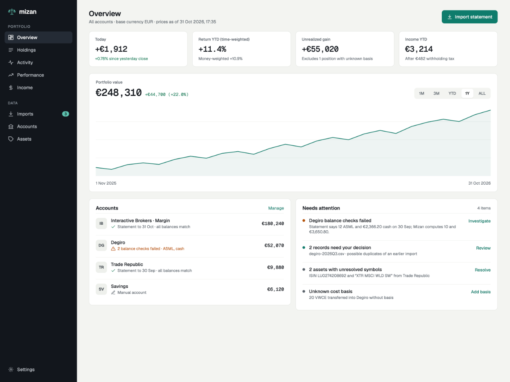
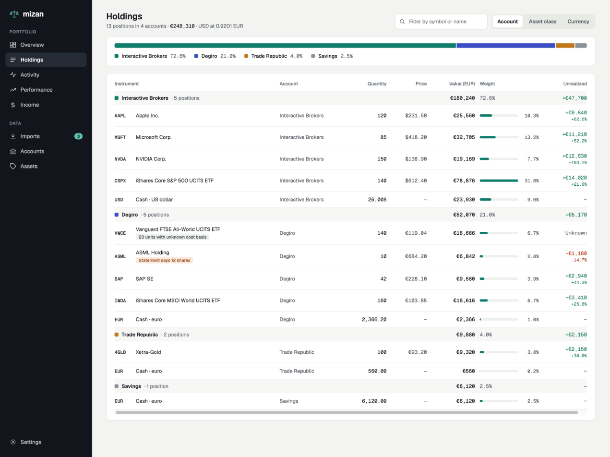
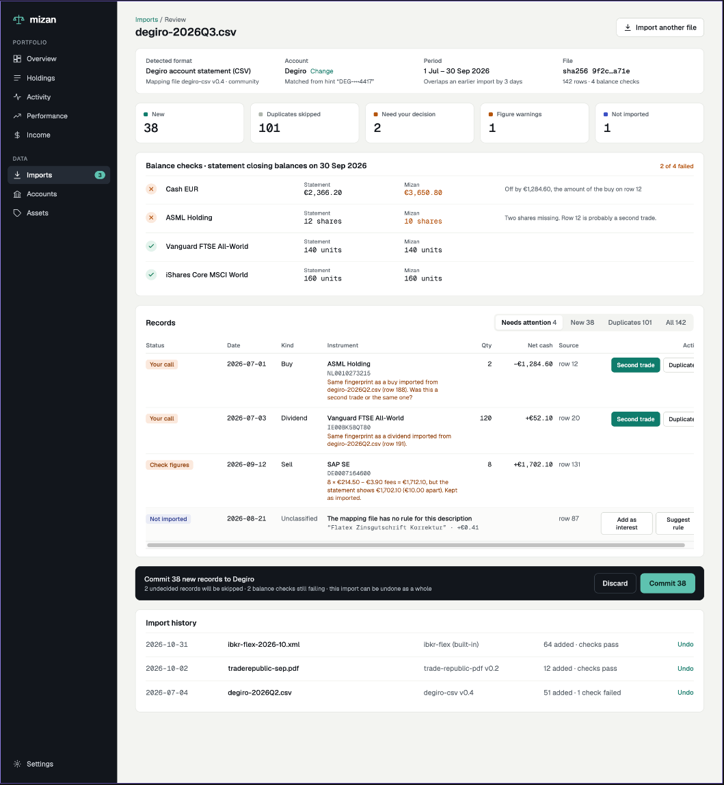
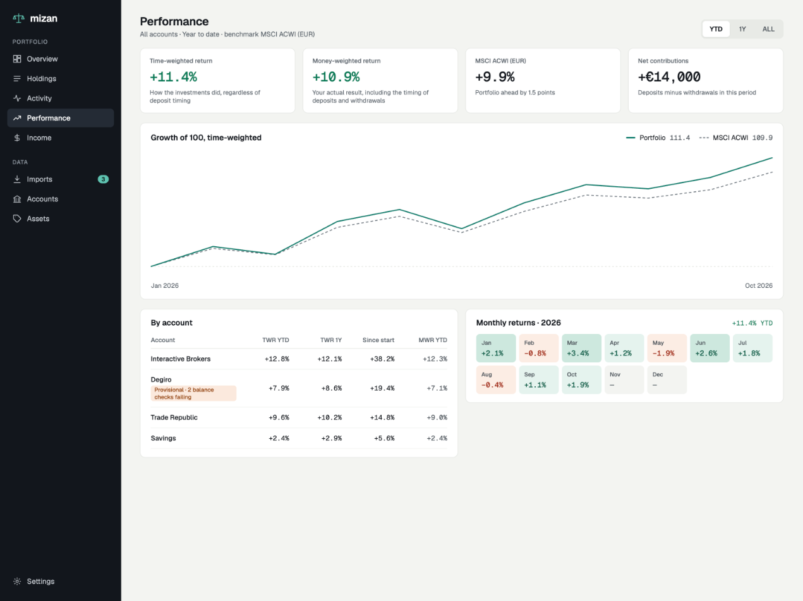

# Mizan

Mizan is a local-first, open-source portfolio tracker. Your data stays on your
device, in a SQLite file you own. No account, no server, no subscription.

What sets Mizan apart is **free and open imports**: broker statements come in
through community-maintained adapters, not a paid sync service. Every import is
reviewed before anything is saved, checked against the balances printed on the
statement, and can be undone.

> **Status: early development.** Imports from statement files, the desktop app
> and market data (TEFAS fund prices, TCMB exchange rates) work today. Returns
> come next.

## What works today

| Area | Status |
|---|---|
| **Import pipeline** | `mizan.import/1` schema and validation, duplicate detection across overlapping statements, figure consistency checks, balance checks against statement closing balances, review report, all-or-nothing commit, undo |
| **Desktop app** | Tauri app with sidebar navigation and native menu; local SQLite database |
| **Adapters** | OFX/QFX bank and investment statements, Interactive Brokers Flex Query XML, Anadolu Hayat Emeklilik pension fund history (XLSX); any CSV or XLSX through the in-app column mapper, saved as a reusable mapping; sandboxed TypeScript scripts for irregular formats |
| **Imports screen** | Open a statement or batch, see which adapter read it and switch to another match, review, map accounts and create assets, decide on possible duplicates, commit, browse history, undo an import |
| **Holdings** | Positions and cash per account with price, value, weight and unrealized gain; provisional average cost; flags for unknown cost basis and failed balance checks |
| **Overview** | Portfolio and account totals in your base currency, latest balance checks, a "needs attention" list |
| **Performance** | Net contributions per account and period |
| **Market data** | Built-in TEFAS (Turkish fund prices) and TCMB (exchange rates) providers, each switchable in Settings; manual prices; refresh on demand or on start |
| **Assets** | Price source per asset, TEFAS suggestions, manual prices, merging duplicate assets |
| **CLI** | `mizan-cli import validate` and `mizan-cli import preview` |

Not yet: time- and money-weighted returns, the value-over-time chart, prices
for listed stocks and ETFs (use manual prices for now), and the AI-assisted
column mapper. Every screen shows real data only;
where something can't be computed yet, it says what is missing instead of
showing a number.

## Design direction

Mockups of the target design ("Ledger" direction). They use sample data and
include features that aren't built yet, such as market value and returns.

| Overview | Holdings |
| --- | --- |
|  |  |
| **Import review** | **Performance** |
|  |  |

## How imports work

```
statement file --> adapter --> mizan.import/1 batch --> review --> commit
                   (mapping file,   (records, balance      (duplicates,
                    TS script or     assertions,            warnings,
                    native Rust)     diagnostics)           balance checks)
```

- **Adapters report; the core interprets.** Adapters write down what the
  statement says, with account and instrument *hints*. Mizan resolves,
  deduplicates and verifies.
- **Balance checks.** Closing balances on a statement are compared with what
  Mizan computes, so a missing transaction is caught at import time.
- **Safe re-imports.** Overlapping statements are deduplicated by fingerprint.
  Matches that can't be decided automatically are left to you.
- **Nothing is final.** Every import can be undone as a whole.

The schema is documented in [docs/import-schema.md](docs/import-schema.md) and
published as JSON Schema in [`schema/`](schema/). Writing an adapter (a
mapping file, a script or native code) is covered in
[docs/adapters.md](docs/adapters.md).

## Getting started

### Desktop app

Requires stable Rust, Node.js 24 and the Tauri CLI
(`cargo install tauri-cli --version "^2"`). On Linux, also install WebKitGTK;
see [docs/desktop.md](docs/desktop.md).

```sh
cd apps/desktop
npm install
cargo tauri dev                  # run with hot reload
cargo tauri build --bundles app  # release app bundle under target/release/bundle/
```

To try it, open **Imports** and load a sample statement from
`adapters/*/fixtures/` (for example
`adapters/ibkr-flex/fixtures/monthly/input.xml`), or the example batches in
`crates/mizan-core/tests/data/e2e/` (`seed.json`, then `batch.json`).

Your data is one SQLite file in the app data folder. See
[docs/desktop.md](docs/desktop.md) for its location, the import flow and what
each screen shows.

### Command line

```sh
cargo run -p mizan-cli -- import validate batch.json
cargo run -p mizan-cli -- import preview batch.json --db mizan.db
```

`preview` prints the review report and writes nothing.

### Tests

```sh
cargo test --workspace
cd apps/desktop && npm test
```

## Project layout

```
crates/mizan-import    mizan.import/1 schema, validation, JSON Schema
crates/mizan-storage   SQLite store and migrations
crates/mizan-core      import pipeline, balance replay, read models, fixture harness
crates/mizan-market    market data providers (TEFAS, TCMB) and refresh
crates/mizan-adapters  adapter runtime: detection, mapping engine, script sandbox, OFX and IBKR Flex
adapters/              bundled adapters with their fixtures, and the script API types
crates/mizan-cli       command-line tools
apps/desktop           React + TypeScript frontend
apps/desktop/src-tauri Tauri host: commands, menu, database location
docs/                  schema, adapter, market data and desktop documentation
```

## Roadmap

1. AI-assisted column mapper that writes mapping files; more bundled adapters
2. Returns engine: time- and money-weighted returns, benchmarks, price history
3. More price providers (listed stocks and ETFs)
4. Tax lots and realized gains

## Contributing

Contributions are welcome, especially broker adapters. Read
[CONTRIBUTING.md](CONTRIBUTING.md) first: it explains the clean-room rule and
how adapter fixtures work, and [docs/adapters.md](docs/adapters.md) for how to
write one.

## License

[MIT](LICENSE)
